# LANCE Container Install Guide (ROS 2 Jazzy in Distrobox)

> [!IMPORTANT]
> **This is the alternative setup. Most people should use the [main install guide](full-install-guide.md)**, which installs ROS 2 Lyrical directly on Ubuntu 26.04.
>
> **Already using this container setup?** Follow the [migration guide](migrate-to-native.md) to switch to the main (native) setup.

This guide runs **ROS 2 Jazzy** and **Gazebo Harmonic** inside an Ubuntu **24.04** "container" on your Ubuntu 26.04 computer, using **Distrobox**. Before ROS 2 Lyrical was available for Ubuntu 26.04, this was the only way to run the project there. Use it if you specifically need Jazzy or Harmonic, for example to reproduce an issue someone sees on the older setup.

> [!TIP]
> **Running Ubuntu 24.04 instead of 26.04?** You don't need a container. Follow the [main install guide](full-install-guide.md), and replace `lyrical` with `jazzy` everywhere in steps 5 and 6.

**How it works:** Distrobox gives you a lightweight Ubuntu 24.04 environment inside your normal system. It shares your home folder, your screen, and your GPU, so it feels like part of your computer, but ROS lives inside it.

---

## Table of Contents

- [Before You Start](#before-you-start)
1. [Install Distrobox and Podman](#1-install-distrobox-and-podman)
2. [Let Containers Use Your NVIDIA GPU](#2-let-containers-use-your-nvidia-gpu-nvidia-gpus-only)
3. [Create the Ubuntu 24.04 Container](#3-create-the-ubuntu-2404-container)
4. [Customize Your Terminal Prompt](#4-customize-your-terminal-prompt)
5. [Enter the Container for the First Time](#5-enter-the-container-for-the-first-time)
6. [Install ROS 2 Jazzy in the Container](#6-install-ros-2-jazzy-in-the-container)
7. [Download, Build, and Run the Code](#7-download-build-and-run-the-code)
8. [Everyday Workflow Cheat Sheet](#8-everyday-workflow-cheat-sheet)
9. [Troubleshooting](#9-troubleshooting)

---

## Before You Start

Complete **steps 0–4 of the [main install guide](full-install-guide.md)** first:

0. [Linux basics](full-install-guide.md#0-linux-basics-youll-need)
1. [Update the system and install Git](full-install-guide.md#1-update-the-system-and-install-git)
2. [Install VS Code](full-install-guide.md#2-install-vs-code)
3. [Install Foxglove](full-install-guide.md#3-install-foxglove)
4. [Install NVIDIA drivers](full-install-guide.md#4-install-nvidia-drivers-nvidia-gpus-only) (NVIDIA GPUs only)

Then come back here.

### Where to run each command
This guide uses two kinds of terminals, and each section is labeled with one:

| Label | Meaning | Prompt looks like |
| - | - | - |
| 🖥️ **HOST** | A normal terminal on your Ubuntu 26.04 computer | `user@computer:~$` |
| 📦 **CONTAINER** | A terminal *inside* the Ubuntu 24.04 distrobox | `[BOX:ros-jazzy] user@computer:~$` |

(You'll set up the `[BOX:ros-jazzy]` marker in [step 4](#4-customize-your-terminal-prompt).)

---

## 1. Install Distrobox and Podman

🖥️ **HOST**

**Podman** is the engine that runs containers, and **Distrobox** is a friendly tool built on top of it that makes containers feel like part of your normal system.

```bash
sudo apt update
sudo apt install -y podman distrobox uidmap
```

(The `-y` flag answers "yes" to the confirmation question automatically.)

Check that both installed correctly. Each command should print a version number:
```bash
podman --version
distrobox --version
podman info
```
`podman info` prints a long block of information. As long as it doesn't show an error, you're good.

<details>
<summary>📷 Example output</summary>

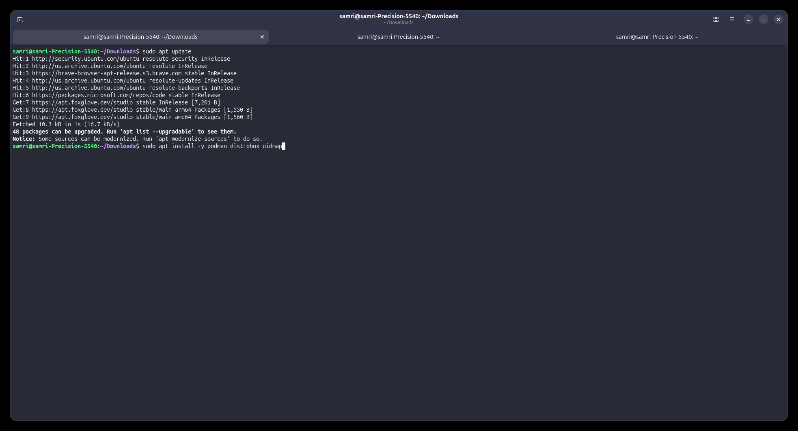

</details>

---

## 2. Let Containers Use Your NVIDIA GPU (NVIDIA GPUs only)

🖥️ **HOST**

> Skip this step if you don't have an NVIDIA GPU.

By default, containers can't see your graphics card. The **NVIDIA Container Toolkit** fixes that, so Gazebo can use your GPU inside the container and run smoothly.

### 2a. Install the NVIDIA Container Toolkit

First, make sure a few helper tools are installed (they usually already are):
```bash
sudo apt install -y curl ca-certificates gnupg
```

Next, add NVIDIA's software source. Copy and paste each of these two blocks **as a whole**. They don't print anything when they succeed (the second one prints a single line).

```bash
curl -fsSL https://nvidia.github.io/libnvidia-container/gpgkey \
  | sudo gpg --dearmor \
      -o /usr/share/keyrings/nvidia-container-toolkit-keyring.gpg
```

```bash
curl -fsSL \
  https://nvidia.github.io/libnvidia-container/stable/deb/nvidia-container-toolkit.list \
  | sed 's#deb https://#deb [signed-by=/usr/share/keyrings/nvidia-container-toolkit-keyring.gpg] https://#g' \
  | sudo tee /etc/apt/sources.list.d/nvidia-container-toolkit.list
```

> If the first command asks `File ... exists. Overwrite? (y/N)`, type `y` and press Enter.

Then install the toolkit:
```bash
sudo apt update
sudo apt install -y nvidia-container-toolkit
```

<details>
<summary>📷 Example output</summary>

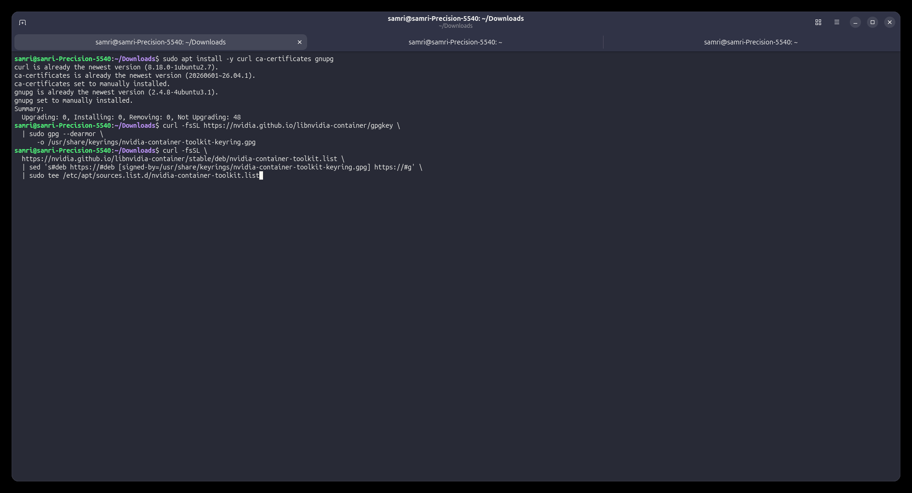

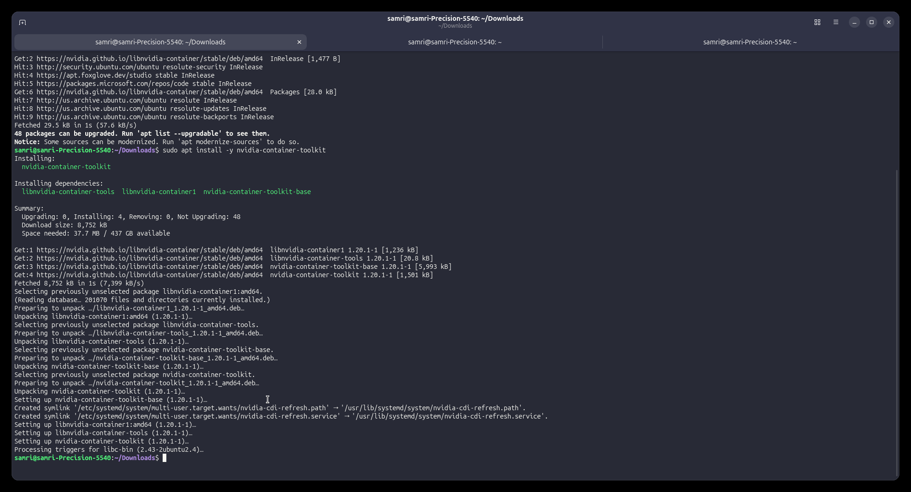

</details>

### 2b. Generate the GPU device description (CDI spec)

This creates a file that tells Podman how to give a container access to your GPU:
```bash
sudo mkdir -p /etc/cdi
sudo nvidia-ctk cdi generate --output=/etc/cdi/nvidia.yaml
```
This prints a **lot** of `INFO` and `WARN` lines. **The `WARN` lines are normal** and can be ignored. The last line should say `Generated CDI spec ...`.

Verify it worked:
```bash
nvidia-ctk cdi list
```
You should see something like:
```
INFO[0000] Found 3 CDI devices
nvidia.com/gpu=0
nvidia.com/gpu=GPU-xxxxxxxx-xxxx-xxxx-xxxx-xxxxxxxxxxxx
nvidia.com/gpu=all
```

<details>
<summary>📷 Example output</summary>

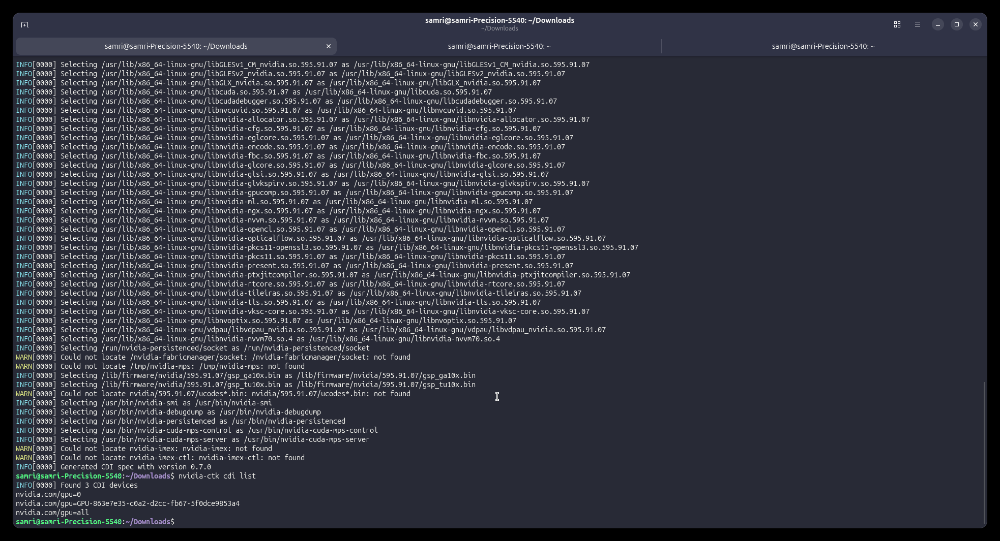

</details>

> [!NOTE]
> If you ever **update your NVIDIA driver**, re-run the `nvidia-ctk cdi generate` command above, or the container may lose GPU access.

---

## 3. Create the Ubuntu 24.04 Container

🖥️ **HOST**

Now create the container. We name it **`ros-jazzy`**, and the rest of this guide uses that name.

**With an NVIDIA GPU:**
```bash
distrobox create \
  --name ros-jazzy \
  --image docker.io/library/ubuntu:24.04 \
  --additional-flags "--device nvidia.com/gpu=all"
```

**Without an NVIDIA GPU:**
```bash
distrobox create \
  --name ros-jazzy \
  --image docker.io/library/ubuntu:24.04
```

When asked `Do you want to pull the image now? [Y/n]`, type **`y`** and press Enter. The command downloads Ubuntu 24.04 and creates the container. When it finishes, you should see `Distrobox 'ros-jazzy' successfully created.`

<details>
<summary>📷 Example output</summary>

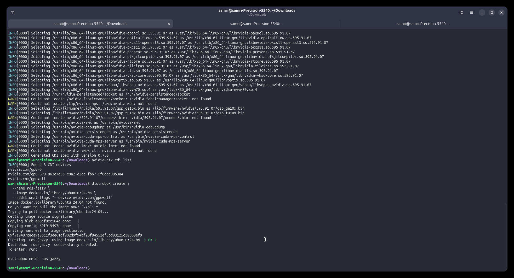

</details>

---

## 4. Customize Your Terminal Prompt

🖥️ **HOST**

Because the container and the host look almost identical in the terminal, it's easy to lose track of which one you're in. This step changes your prompt so container terminals start with **`[BOX:ros-jazzy]`**. It also **automatically loads ROS** whenever you're in the container, so you don't have to remember to.

This works because the container shares your home folder, including your terminal settings file `~/.bashrc`. The code below checks "am I in a container?" and behaves differently in each case.

1. Open the settings file in **nano**, a simple text editor that runs inside the terminal:
   ```bash
   nano ~/.bashrc
   ```

   <details>
   <summary>📷 Screenshot: nano editor</summary>

   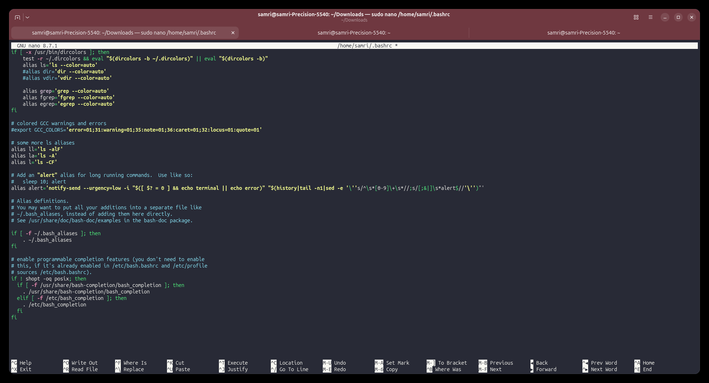

   </details>

2. Scroll to the **very bottom** of the file using the arrow keys, or press `Alt` + `/` to jump there.

3. Paste the following at the bottom (with `Ctrl` + `Shift` + `V`):
   ```bash
   ## --- ROS + environment detection (host vs Distrobox) ---
   if [ -n "$container" ]; then

       if [ -f /opt/ros/jazzy/setup.bash ]; then
           source /opt/ros/jazzy/setup.bash
       fi

       BOLD=$'\[\e[1m\]'
       BLUE="$(tput setaf 4)"
       CYAN="$(tput setaf 6)"
       RESET="$(tput sgr0)"

       PS1="${BOLD}[${CYAN}BOX:${CONTAINER_ID:-container}${RESET}${BOLD}]${RESET} $PS1"

   else
       if [ -f /opt/ros/lyrical/setup.bash ]; then
           source /opt/ros/lyrical/setup.bash
       fi
   fi
   ```

   > What this does:
   > - **In the container:** loads ROS 2 Jazzy (once it's installed) and adds the `[BOX:ros-jazzy]` label to your prompt.
   > - **On the host:** loads ROS 2 Lyrical if it's installed (from the main guide). It does nothing if Lyrical isn't installed.

4. **Save and exit:** press `Ctrl` + `S` to save, then `Ctrl` + `X` to exit.

---

## 5. Enter the Container for the First Time

🖥️ **HOST** → 📦 **CONTAINER**

```bash
distrobox enter ros-jazzy
```

**The first time takes a few minutes**, because Distrobox sets up the container (you'll see a list of `[ OK ]` steps). Later entries take only a second or two.

<details>
<summary>📷 Example output (first entry)</summary>

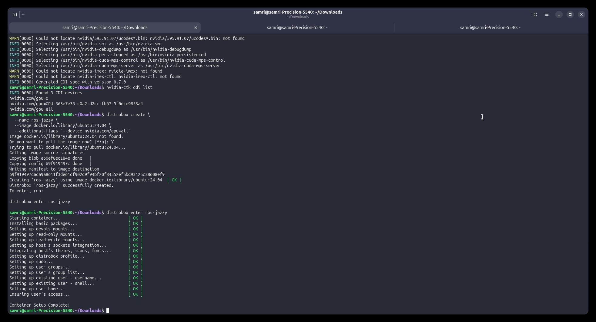

</details>

Once inside, your prompt starts with **`[BOX:ros-jazzy]`**. You're now inside Ubuntu 24.04.

<details>
<summary>📷 Screenshot: the container prompt</summary>

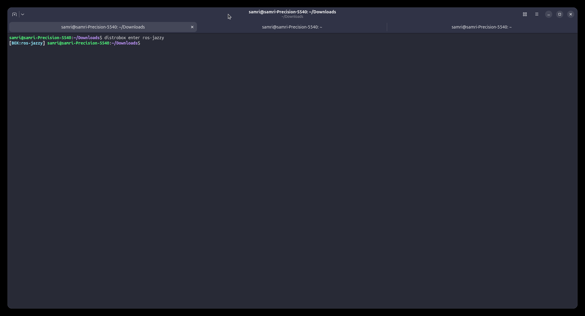

</details>

📦 **CONTAINER**: Run some quick checks:

```bash
cat /etc/os-release
```
This should say `Ubuntu 24.04...` (`noble`), which confirms you're in the container.

**NVIDIA users only:**
```bash
nvidia-smi
ls -l /dev/nvidia*
```
`nvidia-smi` should show the same GPU table you see on the host, and `ls` should list several `/dev/nvidia...` devices. If both work, the GPU passthrough is working.

<details>
<summary>📷 Example output</summary>

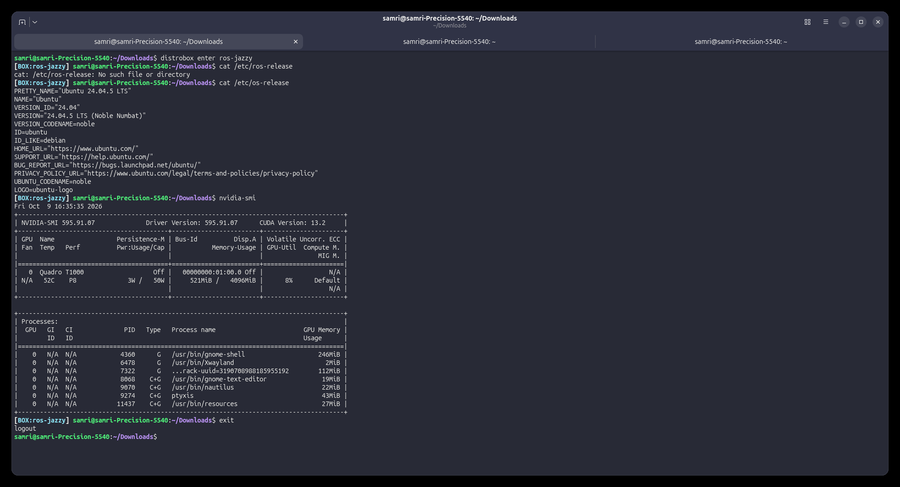

</details>

Now update the container's software:
```bash
sudo apt update
sudo apt upgrade
```

> [!NOTE]
> **To leave the container**, type `exit` (or press `Ctrl` + `D`). You'll return to the host prompt. **To get back in**, run `distrobox enter ros-jazzy` again. Everything you installed in the container stays there.
>
> Your **home folder is shared**, so files you create in `~` inside the container are visible on the host, and vice versa. **Software you install in the container stays in the container** and doesn't affect your host.

---

## 6. Install ROS 2 Jazzy in the Container

📦 **CONTAINER** (your prompt should start with `[BOX:ros-jazzy]`)

These steps follow the [official ROS 2 Jazzy install guide](https://docs.ros.org/en/jazzy/Installation/Ubuntu-Install-Debians.html).

### 6a. Enable the "universe" software source
```bash
sudo apt install software-properties-common
sudo add-apt-repository universe
```
If it says `Press [ENTER] to continue`, press Enter.

<details>
<summary>📷 Example output</summary>

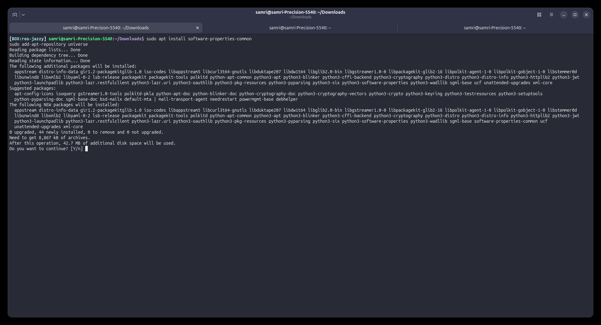

</details>

> You may see some scary-looking lines like `invoke-rc.d: policy-rc.d denied execution` or `Failed to connect to socket /run/dbus/...`. **These are normal inside a container** and can be ignored.

### 6b. Add the ROS 2 software source
Copy and paste these lines all together:
```bash
sudo apt update && sudo apt install curl -y
export ROS_APT_SOURCE_VERSION=$(curl -s https://api.github.com/repos/ros-infrastructure/ros-apt-source/releases/latest | grep -F "tag_name" | awk -F'"' '{print $4}')
curl -L -o /tmp/ros2-apt-source.deb "https://github.com/ros-infrastructure/ros-apt-source/releases/download/${ROS_APT_SOURCE_VERSION}/ros2-apt-source_${ROS_APT_SOURCE_VERSION}.$(. /etc/os-release && echo ${UBUNTU_CODENAME:-${VERSION_CODENAME}})_all.deb"
sudo dpkg -i /tmp/ros2-apt-source.deb
```
The last lines of output should mention `Setting up ros2-apt-source`.

<details>
<summary>📷 Example output</summary>

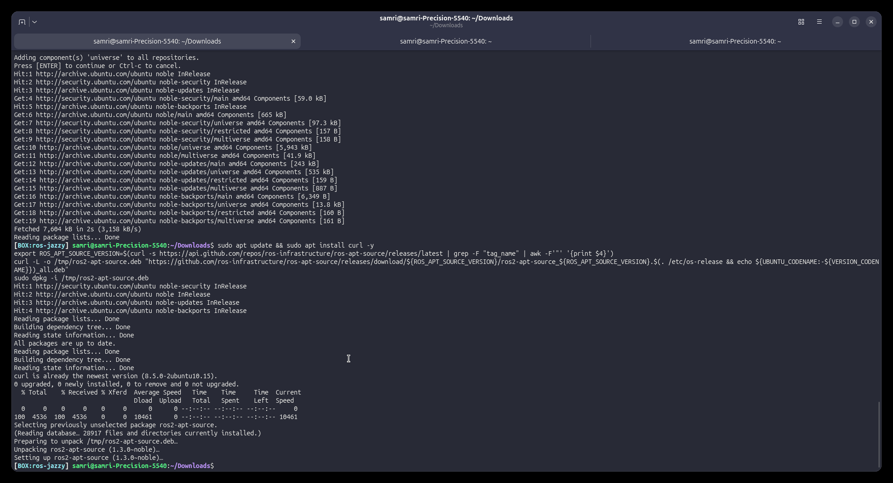

</details>

### 6c. Install the ROS development tools
```bash
sudo apt update && sudo apt install ros-dev-tools -y
```
This installs build tools such as `colcon`, `rosdep`, compilers, and `git`.

<details>
<summary>📷 Example output</summary>

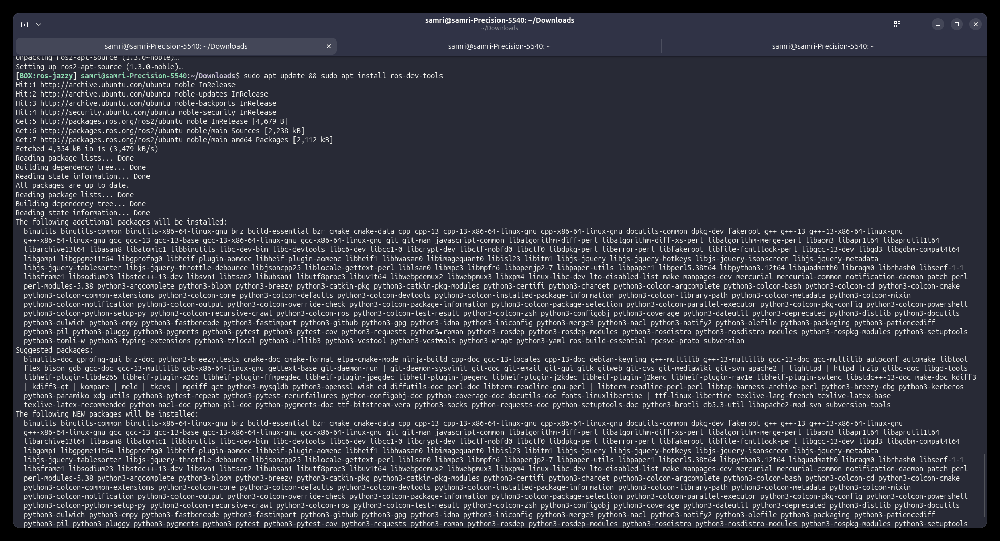

</details>

### 6d. Install ROS 2 Jazzy
```bash
sudo apt install ros-jazzy-ros-base -y
```
This is a big download, so give it a few minutes.

<details>
<summary>📷 Example output</summary>

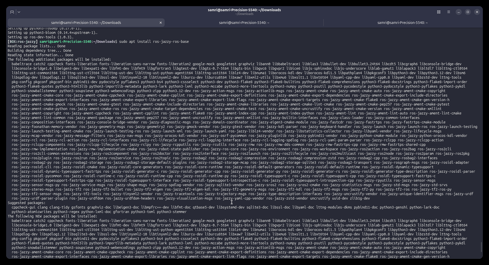

</details>

### 6e. Verify ROS works
The `.bashrc` changes from [step 4](#4-customize-your-terminal-prompt) only load ROS when a **new** terminal starts. Reload them now:
```bash
source ~/.bashrc
```
Then check:
```bash
printenv | grep ROS
```
You should see lines including `ROS_DISTRO=jazzy` and `ROS_VERSION=2`.

```bash
ros2 pkg list
```
This should print a long list of package names. If it does, ROS is installed. 🎉

---

## 7. Download, Build, and Run the Code

📦 **CONTAINER**

From here on, the steps are **exactly the same** as in the main guide. Follow these steps from the [main install guide](full-install-guide.md), running every command **inside the container**:

7. [Download the LANCE code](full-install-guide.md#7-download-the-lance-code)
8. [Install project dependencies](full-install-guide.md#8-install-project-dependencies-and-gazebo) (this installs **Gazebo Harmonic** in the container)
9. [Build the project](full-install-guide.md#9-build-the-project)
10. [Run the simulation](full-install-guide.md#10-run-the-simulation)

Keep these differences in mind while you follow them:
- **Check your prompt before every command.** It should start with `[BOX:ros-jazzy]`. Every new terminal tab starts on the host, so run `distrobox enter ros-jazzy` first.
- **Foxglove runs on the host**, not in the container. In step 10b, open Foxglove normally on your computer. It connects to the simulation in the container at the same `ws://localhost:8765` address.
- `foxglove_gui:=local` may not be able to open Foxglove from inside the container. Open Foxglove by hand instead.

---

## 8. Everyday Workflow Cheat Sheet

```bash
# 🖥️ HOST: open a terminal, then enter the container
distrobox enter ros-jazzy

# 📦 CONTAINER: go to the workspace
cd ~/code/lance-ws

# Pull the latest code (optional)
cd src && git pull && git submodule update --init --recursive && cd ..

# Build after any code change
./src/build.sh

# Run
./src/run.sh gz_full:=lance2_ksc gz_gui:=enabled
```

- **Edit code** in VS Code on the host (`code ~/code/lance-ws`). It sees the same files as the container.
- **Build and run** inside the container.
- **View data** in Foxglove on the host.
- **Each new terminal tab starts on the host.** Run `distrobox enter ros-jazzy` in every tab where you need ROS.

---

## 9. Troubleshooting

For build, dependency, Git LFS, and Foxglove problems, see the [main guide's troubleshooting section](full-install-guide.md#12-troubleshooting). The fixes are the same, just run inside the container. Container-specific problems:

<details>
<summary><b><code>ros2: command not found</code> (inside the container)</b></summary>

- Make sure you're actually **in the container**. Your prompt should start with `[BOX:ros-jazzy]`. If it doesn't, run `distrobox enter ros-jazzy`.
- Run `source ~/.bashrc`, or exit and re-enter the container.
- Check that the snippet from [step 4](#4-customize-your-terminal-prompt) is at the bottom of `~/.bashrc`.
</details>

<details>
<summary><b><code>nano: command not found</code> (inside the container)</b></summary>

`nano` isn't installed in the container by default. Either edit the file from a **host** terminal (it's the same file, since the home folder is shared), or install nano in the container with `sudo apt install nano`.
</details>

<details>
<summary><b><code>nvidia-smi</code> fails inside the container, or Gazebo is very slow</b></summary>

1. Confirm `nvidia-smi` works on the **host**. If it doesn't, revisit [step 4 of the main guide](full-install-guide.md#4-install-nvidia-drivers-nvidia-gpus-only) (and check the Secure Boot/MOK note).
2. Re-generate the CDI spec on the host (needed after every driver update):
   ```bash
   sudo nvidia-ctk cdi generate --output=/etc/cdi/nvidia.yaml
   ```
3. If you created the container **without** the `--additional-flags "--device nvidia.com/gpu=all"` option, delete and recreate it (on the host):
   ```bash
   distrobox rm ros-jazzy
   ```
   Then redo [step 3](#3-create-the-ubuntu-2404-container) and onward. **Your files in `~` are safe**, but you'll need to reinstall the software inside the container.
</details>

<details>
<summary><b>The build fails with errors mentioning <code>/opt/ros/lyrical</code></b></summary>

The workspace was last built natively with ROS 2 Lyrical. The container and the native setup share the same workspace folder, and a build only works with the ROS version that created it. Inside the container, clean and rebuild:
```bash
cd ~/code/lance-ws
./src/build.sh --clean
./src/build.sh
```
</details>

---

*Written for Ubuntu 26.04 host + Ubuntu 24.04 distrobox + ROS 2 Jazzy + Gazebo Harmonic. Last updated: 10/26/26*
