# LANCE Install Guide (Ubuntu 26.04 + ROS 2 Lyrical)

This guide takes you from a **brand-new Ubuntu 26.04 install** to a machine that can **build and run the LANCE code and the Gazebo simulation**. It assumes little or no Linux experience, so it explains every step.

> [!IMPORTANT]
> **Already set up LANCE using the old distrobox container?** Don't start over. Follow the [migration guide](migrate-to-native.md) instead, which moves your existing setup out of the container.

When you're done, you will have:

- **VS Code** for editing code
- **Foxglove** for viewing robot data and controlling the robot
- **NVIDIA graphics drivers**, if your computer has an NVIDIA GPU
- **ROS 2 Lyrical** and **Gazebo Jetty**, the robotics framework and simulator
- The **LANCE code** (plus the `csm-sim` simulation assets), built and ready to run

> [!NOTE]
> Need ROS 2 **Jazzy** (the previous ROS version) instead? See the [container install guide](container-install-guide.md). Most people don't need it.

---

## Table of Contents

0. [Linux Basics You'll Need](#0-linux-basics-youll-need)
1. [Update the System and Install Git](#1-update-the-system-and-install-git)
2. [Install VS Code](#2-install-vs-code)
3. [Install Foxglove](#3-install-foxglove)
4. [Install NVIDIA Drivers](#4-install-nvidia-drivers-nvidia-gpus-only)
5. [Install ROS 2 Lyrical](#5-install-ros-2-lyrical)
6. [Load ROS Automatically in Every Terminal](#6-load-ros-automatically-in-every-terminal)
7. [Download the LANCE Code](#7-download-the-lance-code)
8. [Install Project Dependencies (and Gazebo)](#8-install-project-dependencies-and-gazebo)
9. [Build the Project](#9-build-the-project)
10. [Run the Simulation](#10-run-the-simulation)
11. [Everyday Workflow Cheat Sheet](#11-everyday-workflow-cheat-sheet)
12. [Troubleshooting](#12-troubleshooting)

---

## 0. Linux Basics You'll Need

Skip this section if you're comfortable with the terminal.

### The terminal
Most of this guide runs commands in the **terminal**, a text window where you type commands and press **Enter**. To open one, press **`Ctrl` + `Alt` + `T`**, or press the **Super** (Windows) key, type `terminal`, and press Enter.

### Copying and pasting
- **Paste into the terminal:** `Ctrl` + `Shift` + `V` (plain `Ctrl` + `V` does **not** work)
- **Copy from the terminal:** highlight the text, then press `Ctrl` + `Shift` + `C`
- In this guide, you can copy a whole code block and paste it at once. Commands split across several lines with a `\` at the end of each line count as **one** command.

### `sudo` and your password
Commands starting with **`sudo`** run as administrator, and the terminal asks for **your login password**. **Nothing appears on screen while you type the password** (no dots, no stars). That's normal: type it and press Enter.

### "Do you want to continue? [Y/n]"
When installing software, the terminal often asks for confirmation. Type **`y`** and press **Enter**. The capital letter is the default, so pressing Enter alone also works.

### Reading the prompt
The text before your cursor is the **prompt**. It tells you who and where you are:
```
samri@samri-Precision-5540:~/Downloads$
└─user─┘ └───computer name───┘ └─folder─┘
```
`~` is shorthand for your **home folder** (for example `/home/samri`).

### Useful keys
- **`Ctrl` + `C`**: stop the command that's currently running
- **`Tab`**: autocomplete file and folder names (press it often; it saves typos)
- **`↑` arrow**: bring back the previous command

---

## 1. Update the System and Install Git

Open a terminal and run each command below. These commands refresh the list of available software, install any updates, and install `git`, the tool used to download the code.

```bash
sudo apt update
sudo apt upgrade
sudo apt install git
```

<details>
<summary>📷 Example output of <code>sudo apt update</code></summary>

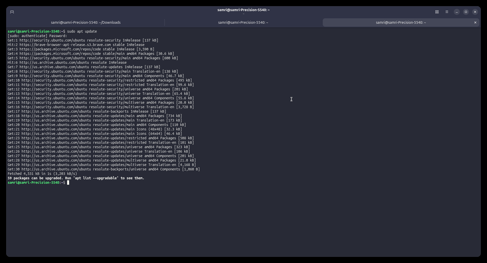

</details>

> [!TIP]
> If `apt upgrade` installed many updates (especially anything with "linux" or "kernel" in the name), restart your computer before continuing.

---

## 2. Install VS Code

VS Code is the code editor we use.

1. Go to **https://code.visualstudio.com/download** and click the **Debian/Ubuntu** button (under Linux). This downloads a `.deb` file, the Ubuntu equivalent of a Windows installer.

   <details>
   <summary>📷 Screenshot: VS Code download page</summary>

   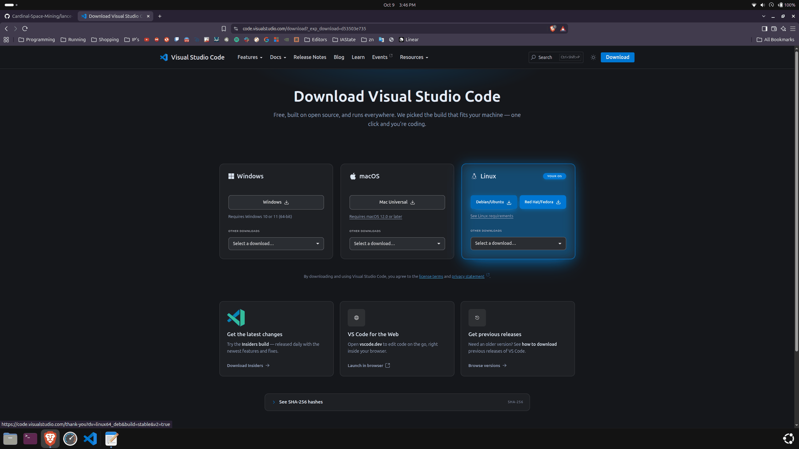

   </details>

2. Open the **Files** app and go to your **Downloads** folder. Click the **⋮** (three dots) menu at the top and choose **Open in Terminal**. This opens a terminal that's already "in" the Downloads folder.

   <details>
   <summary>📷 Screenshot: "Open in Terminal" from the Files app</summary>

   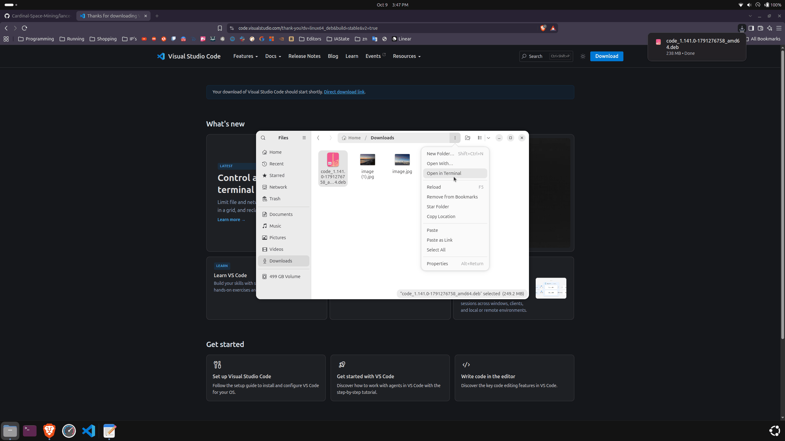

   </details>

   > If you prefer, open a normal terminal and type `cd ~/Downloads` instead.

3. Install the file with `apt`. The exact filename changes with every version, so type `sudo apt install ./code_` and then press **Tab** to autocomplete the rest:
   ```bash
   sudo apt install ./code_<version>_amd64.deb
   ```
   If it asks whether to **add the Microsoft repository**, choose **Yes**. This lets VS Code update itself along with the rest of your system.

   <details>
   <summary>📷 Example output</summary>

   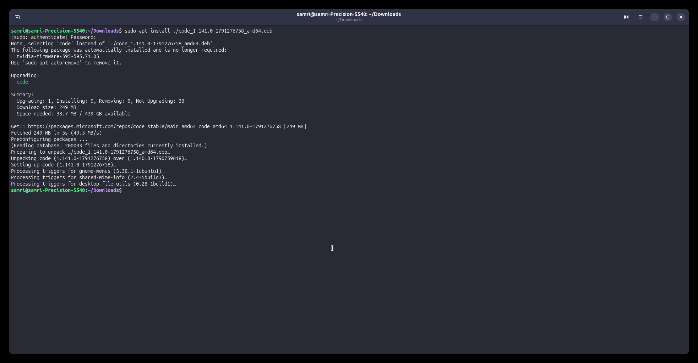

   </details>

4. Launch VS Code by searching for "Visual Studio Code" in the app menu (press Super and type `vscode`), or by typing `code` in a terminal.

   <details>
   <summary>📷 Screenshot: finding VS Code in the app menu</summary>

   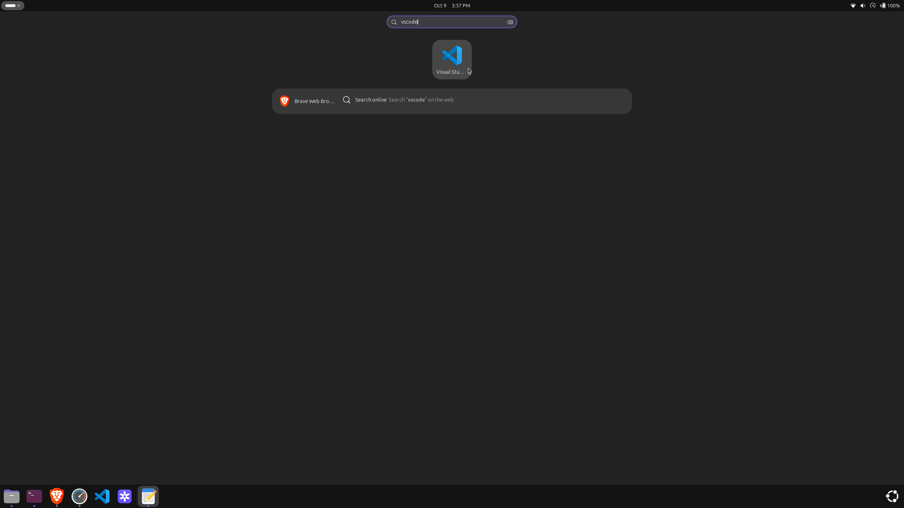

   </details>

---

## 3. Install Foxglove

Foxglove is the dashboard used to view sensor data and control the robot, both the real one and the simulated one.

1. Go to **https://foxglove.dev/download**, choose the **Linux** tab, and click **Download x64** (use **arm64** only if you're on an ARM computer, which is rare).

   <details>
   <summary>📷 Screenshot: Foxglove download page</summary>

   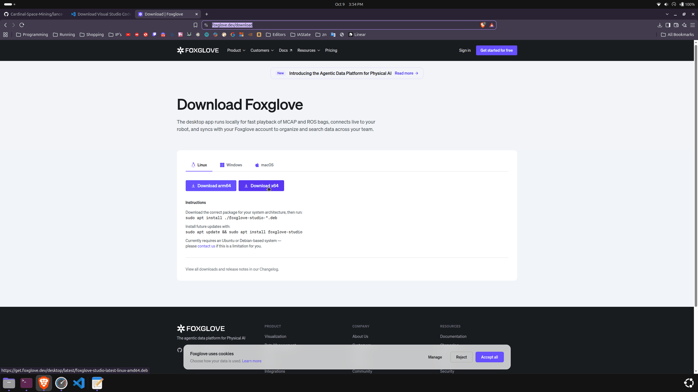

   </details>

2. Open a terminal in your Downloads folder (same as in the VS Code step) and install it:
   ```bash
   sudo apt install ./foxglove-studio-latest-linux-amd64.deb
   ```

   <details>
   <summary>📷 Example output</summary>

   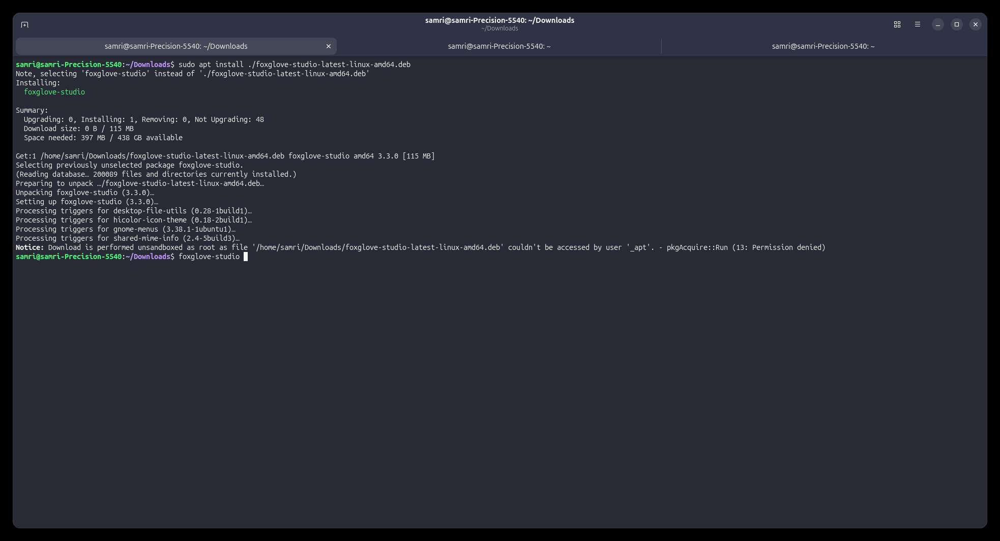

   > The `Notice: Download is performed unsandboxed as root...` line at the end is harmless and can be ignored.

   </details>

3. Open Foxglove from the app menu, or by typing `foxglove-studio` in a terminal.

4. **Sign in or create a free account.** Clicking the button opens your web browser. Confirm that the code shown in the browser matches the code in the app, click **Authorize**, then click **Open Foxglove** to return to the app.

   <details>
   <summary>📷 Screenshots: signing in</summary>

   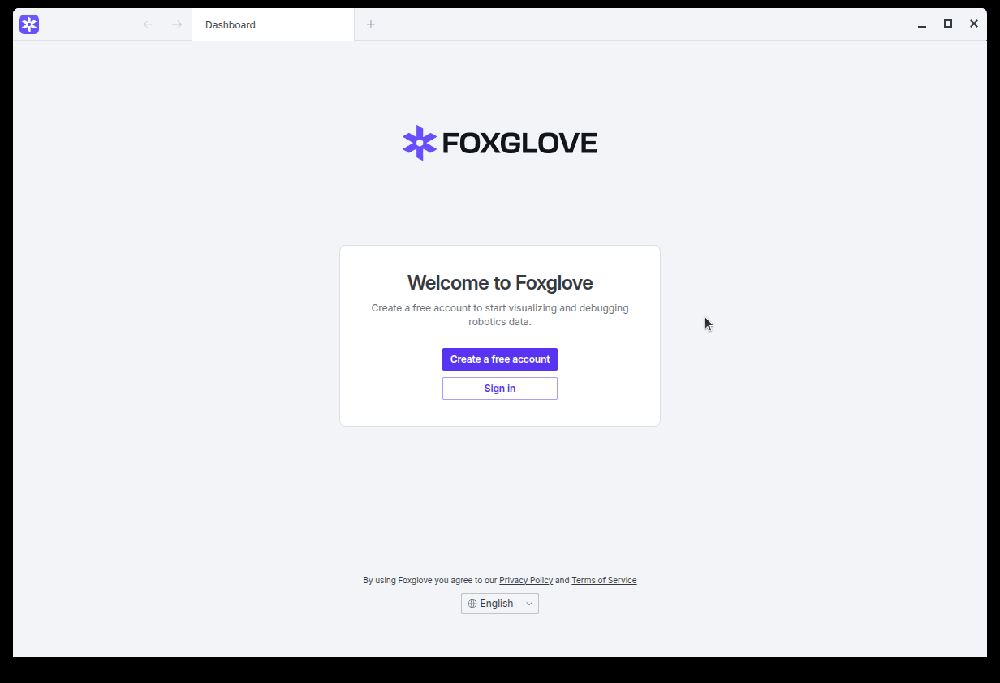

   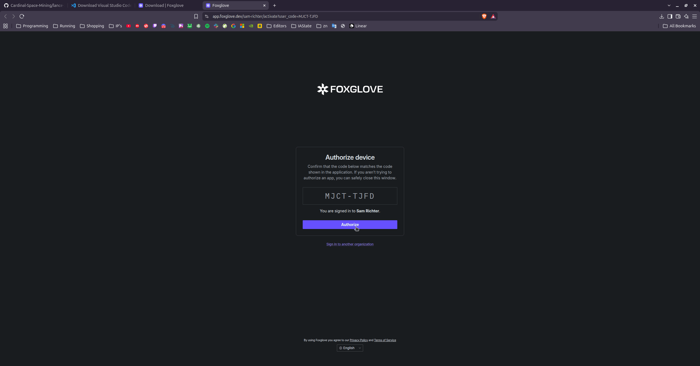

   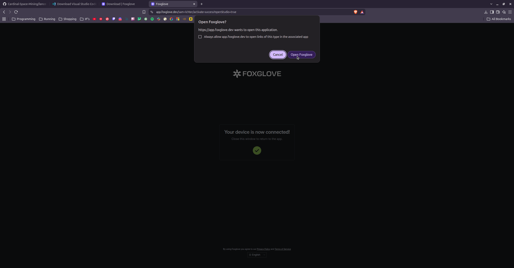

   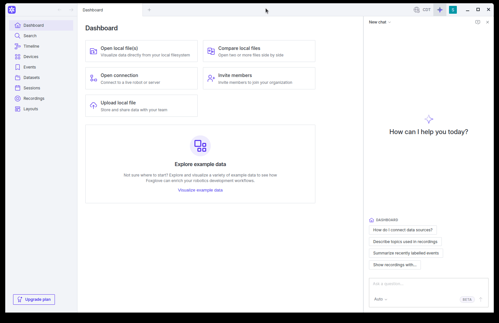

   </details>

5. **Install the required extensions.** Click your profile icon (top-right) and choose **Extensions**. Search for and install each of these:
   - **Bar Display**
   - **Button**
   - **String Panel**

   <details>
   <summary>📷 Screenshot: Extensions menu</summary>

   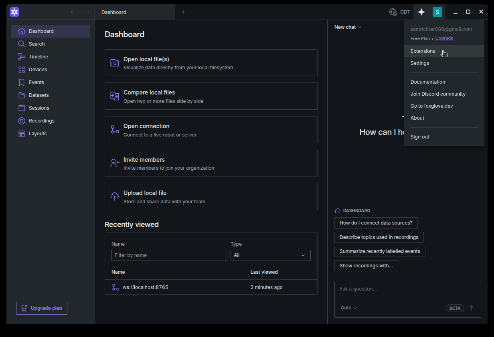

   </details>

---

## 4. Install NVIDIA Drivers (NVIDIA GPUs only)

> [!IMPORTANT]
> **No NVIDIA graphics card?** If your computer only has Intel or AMD graphics, **skip this step**.
>
> **Not sure?** Run `lspci | grep -i nvidia`. If it prints anything, you have an NVIDIA GPU.
>
> **Using WSL on Windows?** **Skip this step.** Don't install NVIDIA drivers inside Ubuntu. Follow the [WSL guide](wsl-guide.md#3-make-gazebo-use-your-gpu) instead.

1. **Check whether a driver is already installed.** The Ubuntu installer sometimes installs one for you:
   ```bash
   nvidia-smi
   ```
   If this prints a table showing your GPU (like the screenshot below), you already have a driver and can skip to [step 5](#5-install-ros-2-lyrical). If it says `command not found` or fails, continue.

2. **List the available drivers:**
   ```bash
   ubuntu-drivers list
   ```
   To see which one Ubuntu **recommends** for your GPU, run:
   ```bash
   sudo ubuntu-drivers devices
   ```
   Look for the line ending in **`recommended`**.

3. **Install the driver**, replacing `###` with the version number you chose (for example `595` or `595-open`):
   ```bash
   sudo apt install nvidia-driver-###
   ```
   Choose the **recommended** one. If in doubt, pick the highest-numbered version that does **not** include `server` in its name.

   > [!WARNING]
   > If your computer has **Secure Boot** enabled, the installer may ask you to create a password. On the next reboot you'll see a blue **"MOK management"** screen. Choose **Enroll MOK → Continue → Yes**, and enter that same password. If you skip this, the driver won't load.

4. **Reboot** your computer:
   ```bash
   reboot
   ```

5. **Confirm it works:**
   ```bash
   nvidia-smi
   ```
   You should see a table with your GPU's name, driver version, and memory usage.

<details>
<summary>📷 Example output of <code>ubuntu-drivers list</code> and <code>nvidia-smi</code></summary>

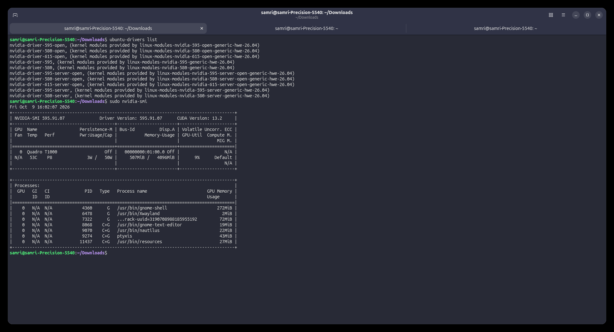

</details>

---

## 5. Install ROS 2 Lyrical

**ROS 2** (Robot Operating System) is the framework all of the LANCE code is built on. **Lyrical** is the version made for Ubuntu 26.04. These steps follow the [official ROS 2 Lyrical install guide](https://docs.ros.org/en/lyrical/Installation/Ubuntu-Install-Debs.html).

### 5a. Check your locale
ROS needs a UTF-8 "locale" (language setting). A normal Ubuntu desktop install already has one. Check with:
```bash
locale | grep LANG=
```
If the result ends in `UTF-8` (for example `LANG=en_US.UTF-8`), you're good. If not, see the [official guide's locale step](https://docs.ros.org/en/lyrical/Installation/Ubuntu-Install-Debs.html).

### 5b. Enable the "universe" software source
```bash
sudo apt install software-properties-common
sudo add-apt-repository universe
```
If it says `Press [ENTER] to continue`, press Enter. It may also say universe is already enabled, which is fine.

### 5c. Add the ROS 2 software source
Copy and paste these lines all together:
```bash
sudo apt update && sudo apt install curl -y
export ROS_APT_SOURCE_VERSION=$(curl -s https://api.github.com/repos/ros-infrastructure/ros-apt-source/releases/latest | grep -F "tag_name" | awk -F'"' '{print $4}')
curl -L -o /tmp/ros2-apt-source.deb "https://github.com/ros-infrastructure/ros-apt-source/releases/download/${ROS_APT_SOURCE_VERSION}/ros2-apt-source_${ROS_APT_SOURCE_VERSION}.$(. /etc/os-release && echo ${UBUNTU_CODENAME:-${VERSION_CODENAME}})_all.deb"
sudo dpkg -i /tmp/ros2-apt-source.deb
```
The last lines of output should mention `Setting up ros2-apt-source`.

### 5d. Install the ROS development tools
```bash
sudo apt update && sudo apt install ros-dev-tools -y
```
This installs build tools such as `colcon`, `rosdep`, and compilers.

### 5e. Update your system, then install ROS 2 Lyrical
ROS packages are built against an up-to-date Ubuntu, so update first:
```bash
sudo apt upgrade
```
Then install ROS:
```bash
sudo apt install ros-lyrical-ros-base -y
```
This is a big download, so give it a few minutes.

> [!TIP]
> `ros-lyrical-ros-base` is all the project needs. If you also want ROS GUI tools such as RViz, install `ros-lyrical-desktop` instead (it includes everything in `ros-base`).

---

## 6. Load ROS Automatically in Every Terminal

ROS commands only work in a terminal after you "source" (load) its setup file. To avoid doing that by hand every time, add it to `~/.bashrc`, a settings file that runs whenever a terminal opens:

```bash
echo '[ -f /opt/ros/lyrical/setup.bash ] && source /opt/ros/lyrical/setup.bash' >> ~/.bashrc
```

> This adds one line to the end of `~/.bashrc`. **Run it only once**, or you'll add the line several times. In plain English, the line says: "if ROS 2 Lyrical is installed, load it."

**Close your terminal and open a new one**, then check that ROS loads:
```bash
printenv | grep ROS_DISTRO
```
This should print `ROS_DISTRO=lyrical`.

```bash
ros2 pkg list
```
This should print a long list of package names. If it does, ROS is installed. 🎉

---

## 7. Download the LANCE Code

From here on, the steps follow the project's [`README.md`](../README.md), with extra explanation added.

### 7a. Install Git LFS
The simulation repo stores large 3D models using **Git LFS** ("Large File Storage"). Install it **before** cloning, so the large files download automatically:
```bash
sudo apt install git-lfs
git lfs install
```

### 7b. Create the workspace and clone the main repo
A ROS "workspace" is a folder that holds your code in a subfolder named `src`. We'll put it at `~/code/lance-ws`; you can choose another location, but the rest of this guide assumes this one.

```bash
mkdir -p ~/code/lance-ws
cd ~/code/lance-ws
git clone --recurse-submodules -b main https://github.com/Cardinal-Space-Mining/lance-2026 src
```
The repo downloads **into a folder named `src`**. `--recurse-submodules` also downloads the other repos this project includes.

> If you forgot `--recurse-submodules`, or need to update the submodules later, run this from inside `~/code/lance-ws/src`:
> ```bash
> git submodule update --init --recursive
> ```

### 7c. Clone the simulation repo
> [!IMPORTANT]
> **Clone `csm-sim` before installing dependencies in step 8.** The simulation package is what tells `rosdep` to install **Gazebo**. If it isn't there yet, Gazebo won't get installed.

```bash
cd ~/code/lance-ws/src
git clone https://gitlab.com/csm2.0/csm-sim
cd ~/code/lance-ws
```

Check that the large files were actually downloaded:
```bash
cd ~/code/lance-ws/src/csm-sim
git lfs ls-files
```
Each file in the list should have a `*` after its ID (meaning it's downloaded), not a `-`. If you see `-`, or you cloned before installing Git LFS, fetch them manually **from inside the `csm-sim` folder**:
```bash
git lfs fetch
git lfs checkout
```
Then return to the workspace:
```bash
cd ~/code/lance-ws
```

> `csm-sim` has its own README with Isaac Sim/Gazebo background. You don't need to follow it for this guide, because everything it requires is covered here.

Your workspace should now look like this:
```
~/code/lance-ws/
└── src/
    ├── README.md
    ├── build.sh
    ├── run.sh
    ├── csm-sim/
    ├── lance/
    ├── cardinal-perception/
    └── ... (other packages)
```

---

## 8. Install Project Dependencies (and Gazebo)

Run everything in this step from `~/code/lance-ws`:
```bash
cd ~/code/lance-ws
```

### 8a. Install ROS dependencies with rosdep
`rosdep` reads every package in the workspace and installs whatever each one needs. **This is the step that installs Gazebo**, through the `csm-sim` package.

First-time setup only:
```bash
sudo rosdep init
rosdep update
```
> If `sudo rosdep init` says the file `already exists`, that's fine. Just continue with `rosdep update`.

Then install everything:
```bash
rosdep install --ignore-src --from-paths src -r -y
```
This can take a while, since it downloads a lot of packages.

### 8b. Add extra software sources
Some libraries come from outside Ubuntu's normal sources, so add those sources first.

**Phoenix 6** (motor controller library from CTR Electronics):
```bash
YEAR=2026
sudo curl -s --compressed -o /usr/share/keyrings/ctr-pubkey.gpg "https://deb.ctr-electronics.com/ctr-pubkey.gpg"
sudo curl -s --compressed -o /etc/apt/sources.list.d/ctr${YEAR}.list "https://deb.ctr-electronics.com/ctr${YEAR}.list"
```

**OSRF/Gazebo source** (used here to get the `zenoh` networking libraries):
```bash
sudo curl https://packages.osrfoundation.org/gazebo.gpg --output /usr/share/keyrings/pkgs-osrf-archive-keyring.gpg
echo "deb [arch=$(dpkg --print-architecture) signed-by=/usr/share/keyrings/pkgs-osrf-archive-keyring.gpg] https://packages.osrfoundation.org/gazebo/ubuntu-stable $(lsb_release -cs) main" | sudo tee /etc/apt/sources.list.d/gazebo-stable.list > /dev/null
```

### 8c. Install the remaining packages
```bash
sudo apt update
sudo apt install libpcl-dev libopencv-dev python3-netifaces phoenix6 patchelf libzenohc-dev libzenohcpp-dev
```

---

## 9. Build the Project

From `~/code/lance-ws`:
```bash
cd ~/code/lance-ws
./src/build.sh
```

The first build takes a **long time** (possibly 10+ minutes, depending on your computer). You'll see lots of text scroll by. Yellow **warnings** are normal. When it finishes, you should see:
```
>> Build finished in XXX seconds.
```

> [!TIP]
> Some code is compiled twice, once for each robot (LANCE-1 and LANCE-2). If you only care about one robot, you can roughly halve the build time:
> - `./src/build.sh --l1`: build for LANCE-1 only
> - `./src/build.sh --l2`: build for LANCE-2 only
>
> The build script also automatically uses fewer parallel jobs when your computer is low on free memory, to avoid crashing.

The build creates three new folders next to `src`: `build/`, `install/`, and `log/`. You don't need to touch them. To wipe them and start fresh, run `./src/build.sh --clean`.

---

## 10. Run the Simulation

### 10a. Start the simulation
From `~/code/lance-ws`:
```bash
./src/run.sh gz_full:=lance2_ksc gz_gui:=enabled
```
This launches Gazebo with **LANCE-2 in the KSC arena**, along with the full robot software stack and a Foxglove connection. A Gazebo window should open on your desktop. The first launch can take a minute or so.

> [!NOTE]
> By default, the simulator runs **headless** (no Gazebo window). `gz_gui:=enabled` opens the 3D view. You can leave it off to save resources and use Foxglove alone, which is handy on slower laptops.

Other simulation options follow the pattern `<mode>:=<robot>_<arena>`:

| Mode | What it runs |
| - | - |
| `gz_full` | Simulator + robot code + client code (everything) |
| `gz_robot` | Simulator + robot code only |
| `gz_client` | Simulator + client code only |

| Robot / arena options |
| - |
| `lance1_ksc`, `lance1_ucf_left`, `lance1_ucf_right` |
| `lance2_ksc`, `lance2_ucf_left`, `lance2_ucf_right` |

For example: `./src/run.sh gz_full:=lance1_ucf_left gz_gui:=enabled`. All presets are defined in [`lance/config/presets/`](../lance/config/presets/). See the [README](../README.md#running) for robot/client (non-simulation) examples and the `--local` / `--canbus` flags.

**To stop the simulation**, click into the terminal and press `Ctrl` + `C`.

### 10b. Connect Foxglove
1. Open Foxglove.
2. Click **Open connection**, keep the **Foxglove WebSocket** option, use the URL `ws://localhost:8765`, and click **Open**.
3. Load the project's dashboard layout: click the **Layout** dropdown (top-right), choose **Import from file...**, and select:
   ```
   ~/code/lance-ws/src/foxglove_layout.json
   ```
   (In the file picker, press `Ctrl` + `H` to show hidden folders if needed, or type the path directly.)

You should now see live data from the simulated robot. 🚀

> [!TIP]
> `foxglove_gui:=local` makes Foxglove open and connect automatically when the simulation starts:
> ```bash
> ./src/run.sh gz_full:=lance2_ksc gz_gui:=enabled foxglove_gui:=local
> ```

---

## 11. Everyday Workflow Cheat Sheet

Once everything is set up, a typical session looks like this:

```bash
# Open a terminal and go to the workspace
cd ~/code/lance-ws

# Pull the latest code (optional)
cd src && git pull && git submodule update --init --recursive && cd ..

# Build after any code change
./src/build.sh

# Run
./src/run.sh gz_full:=lance2_ksc gz_gui:=enabled
```

- **Edit code** in VS Code: open the `~/code/lance-ws` folder (`code ~/code/lance-ws`). See the [VSCode section of the README](../README.md#vscode) for IntelliSense and formatting settings.
- **View data** in Foxglove.

---

## 12. Troubleshooting

<details>
<summary><b><code>ros2: command not found</code>, or <code>ROS_DISTRO</code> isn't <code>lyrical</code></b></summary>

- Open a **new** terminal (or run `source ~/.bashrc`).
- Check that `/opt/ros/lyrical/setup.bash` exists. If it doesn't, ROS didn't install. Redo [step 5e](#5e-update-your-system-then-install-ros-2-lyrical).
- Check that the line from [step 6](#6-load-ros-automatically-in-every-terminal) is at the bottom of `~/.bashrc`. View the end of the file with `tail ~/.bashrc`.
</details>

<details>
<summary><b>Gazebo models look broken or missing / errors about invalid mesh files</b></summary>

The Git LFS files probably weren't downloaded. From inside `~/code/lance-ws/src/csm-sim`:
```bash
git lfs install
git lfs fetch
git lfs checkout
```
Then rebuild.
</details>

<details>
<summary><b>The build fails with "package not found" / missing dependency errors</b></summary>

Re-run the dependency steps from `~/code/lance-ws`:
```bash
rosdep update
rosdep install --ignore-src --from-paths src -r -y
```
Also double-check that the apt packages from [step 8c](#8c-install-the-remaining-packages) installed without errors.
</details>

<details>
<summary><b>The build freezes or the computer becomes unresponsive</b></summary>

The build ran out of memory. Close other programs (especially browsers), then build only one robot version with `./src/build.sh --l2` (or `--l1`). You can also limit parallel jobs manually:
```bash
MAKEFLAGS="-j 2" ./src/build.sh --l2
```
</details>

<details>
<summary><b>Gazebo is very slow</b></summary>

**On WSL?** See the [WSL guide's GPU fix](wsl-guide.md#3-make-gazebo-use-your-gpu). Gazebo renders on the CPU unless you apply it.

If you have an NVIDIA GPU, run `nvidia-smi` and check that your GPU shows up. If it doesn't, revisit [step 4](#4-install-nvidia-drivers-nvidia-gpus-only) (and check the Secure Boot/MOK note). You can also run the simulation without `gz_gui:=enabled` and use Foxglove only.
</details>

<details>
<summary><b>Foxglove can't connect to <code>ws://localhost:8765</code></b></summary>

- Make sure the simulation is **running** and hasn't exited with an error. Scroll up in its terminal to check.
- Use a preset that enables the Foxglove bridge (all the `gz_*` presets do).
</details>

---

*Written for Ubuntu 26.04 + ROS 2 Lyrical + Gazebo Jetty. Last updated: 10/26/26*
